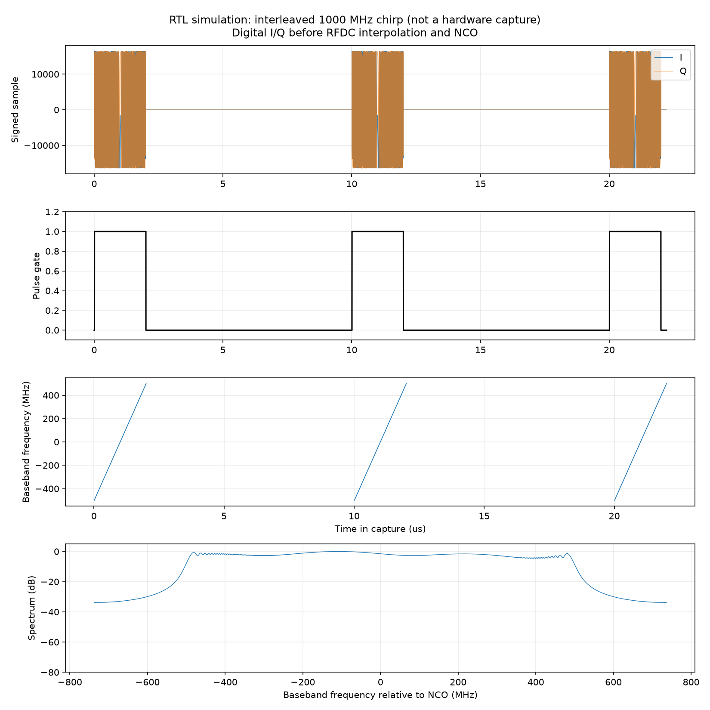

# ZCU208 pulsed LFM chirp generator

RF-DAC **tile 228 / channel 0**, CLK104 245.76 MHz reference, local RFDC PLL,
5.89824 GSPS, 8x interpolation, four complex samples per 184.32 MHz fabric cycle.
Vivado JTAG-to-AXI control; no Vitis/PetaLinux required.

**Clock correction:** CLK104's connector reference goes to DAC tile 228.
Tile 230 uses a separate external SMA clock path. The original tile-230 assumption
and default split-I/Q packing were incorrect for this setup.

**Board readiness:** the branch includes reset/CDC fixes, but still requires a
fresh Vivado build, timing/CDC review and a controlled RF measurement. See the
[29 September review and bring-up checks](docs/review_2026-09-29.md).
DAC-domain reset now leaves output disabled until a fresh APPLY; a tile restart
also leaves output off.

## Build and run

Vivado 2022.2+ with production ZCU208 board files, from the repository root:

```tcl
source tcl/build_bd.tcl
```

Generate Bitstream, then program matching `.bit` and `.ltx` files. The ILA is
included by default. An implementation hook ties its debug hub to the independent
100 MHz AXI clock; its sample clock remains in the DAC domain.

Program CLK104 with a profile enabling **LMK DCLKout6 at 245.76 MHz** before
starting the RFDC. These scripts do not program the clock card.

```tcl
source tcl/chirp_ctrl.tcl
hw_init
rfdc_status                 ;# tile 228: state 15, power-up 1, PLL locked 1
clock_check                 ;# changing DAC fabric heartbeat
# rfdc_restart              ;# if clocks were configured after the bitstream
nco_set 500e6
chirp -bw 400e6 -pw 2e-6 -pri 10e-6 -amp 0.5
source tcl/ila_capture.tcl
ila_capture out/chirp.csv
# gen_off
```

## View the chirp

The ILA contains the full 128-bit stream, pulse gate, TVALID/TREADY and eight
16-bit I/Q lane probes. View lanes as **Signed Decimal / Analog** in Vivado.
To reconstruct all four samples per clock and plot the chirp correctly:

```sh
python -m pip install -r sim/requirements.txt
python scripts/plot_ila.py out/chirp.csv
```

This writes `out/chirp.png` with I/Q samples, pulse gate and instantaneous
**baseband** frequency. ILA observes digital samples before the RFDC; actual
analog RF output requires a scope/analyzer or a separate ADC loopback capture.

**[Türkçe kurulum, saat teşhisi ve ILA rehberi](docs/bringup_tr.md)** includes the
probe map, expected results, clock path, balun bandwidth and hardware checks.

## Tests

```sh
# Icarus Verilog 12+, Python with requirements above, Tcl 8.5+
bash sim/run_iverilog.sh
# Alternative: Verilator 5+ and a C++20 compiler
# bash sim/run_verilator.sh
```

The RTL testbench checks every sample against a bit-exact reference and includes
an interleaved pulsed chirp capture. Tcl tests mock AXI accesses; Python tests
check signed lane reconstruction and invalid captures. For Vivado xsim use
`source tcl/sim_project.tcl` or `sim/run_xsim.bat` / `sim/run_xsim.sh`.

Vivado IP validation, synthesis/implementation timing and board measurements
remain required; host tests cannot validate the RFDC PLL or analog output.

## Verified RTL example



This plot comes from RTL simulation, not a ZCU208 hardware capture.

